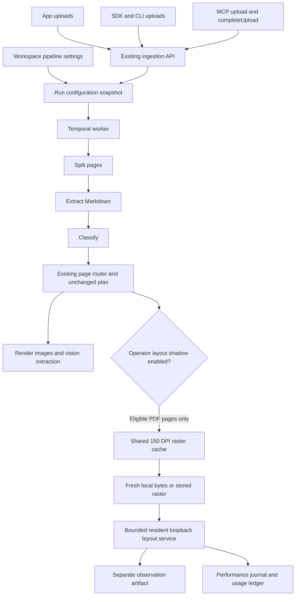

# Image layout in the production pipeline

The first integration is an **operator-enabled PDF layout observer in shadow mode**. It records what the resident detector sees after the existing router makes its plan. It does not change extraction assignments, skip OCR, or reduce paid calls. Current completeness results do not justify an automatic accept path; see the [confirmation findings](image-layout-confirmation-2026-10-20.md).

This describes code integration and remaining rollout work, not a deployed capability. The private app's declared Fly configuration uses the lean worker image on `shared-cpu-8x` with 16 GB RAM and sets `PAGE_ROUTER_MODE=shadow` on app and worker. Live fleet state must be verified separately.

## Existing platform path

[Stage assembly](../worker/src/stages/index.ts) shares the source cache, raster cache and observer within the worker's stage instances. [RoutePagesStage](../worker/src/stages/route-pages.ts) retains existing workspace/platform router gates. It samples pages whose plan needs pixels and that do not satisfy the existing healthy-text predicate. Running after planning establishes observation cost and candidate evidence, not before-paid-call savings.

When no pages are eligible, shadow adds no raster work or observation-artifact PUT; it records a performance summary only. Result rows have an aggregate 16 MiB budget: an oversized result is marked omitted and further page observations stop.

Selection currently takes eligible pages in document order. It is not a randomized quality audit. Audit a model-blind sample of native bypasses before claiming completeness for this selection policy.

## Configuration and existing integrations

There is no new workspace layout schema in this iteration. Layout is operator-only, controlled by `PAGE_ROUTER_LAYOUT=off|shadow`, default `off`. Existing `pipeline.pageRouter` remains the public routing configuration.

| Integration | Existing interface | Effect |
| --- | --- | --- |
| REST | `PATCH /v1/workspaces/:workspaceId`, [updateWorkspaceSchema](../packages/shared/src/workspace.ts) | Existing `pipeline.pageRouter` configures routing. Server API keys require `workspaces:manage` and workspace access. Preserve existing pipeline settings when updating. |
| SDK | [updateWorkspace(id, input)](../packages/sdk/src/index.ts) | Same workspace contract; no separate layout endpoint or upload option. |
| CLI | [upload and ingest-url](../packages/cli/src/index.ts) | Inherits target workspace configuration. No new layout-specific switch. |
| MCP | [upload, completeUpload and getUploadStatus](../server/src/services/mcp-catalog.ts) | Inherits workspace behavior through existing ingestion. No new layout-specific settings tool. |
| App | Existing upload, progress and inspection flows | Input and extraction contracts stay the same. Observation-overlay UI is separate work. |

[Run creation](../server/src/services/run-creation.ts) snapshots workspace settings. [Shared routing configuration](../packages/shared/src/pipeline.ts) caps requested router mode by worker `PAGE_ROUTER_MODE`; explicit workspace `off` remains off. An unset workspace mode defaults to shadow when the platform enables shadow or active. Active extraction remains explicit opt-in.

Existing router shadow mode can execute configured paid decision-model calls. The new observer adds no paid model API calls, but adds local work and can materialize a raster that otherwise would not be rendered in a shadow-only run.

## Resident service and bounds

[Observer configuration](../worker/src/layout/routing-observer.ts) requires, when enabled:

- `PAGE_ROUTER_LAYOUT_ENDPOINT`: `http://127.0.0.1:<port>/layout`, without credentials, query or redirect.
- `PAGE_ROUTER_LAYOUT_MODEL_ID`, `PAGE_ROUTER_LAYOUT_REVISION` and `PAGE_ROUTER_LAYOUT_ARTIFACT_SHA256`: expected identity and exact artifact digest.
- `PAGE_ROUTER_LAYOUT_PROFILE_SHA256`: the approved `/health` response's `inferenceProfileSha256`, pinning the inference configuration as well as the model.
- `PAGE_ROUTER_LAYOUT_DEVICE`: defaults to `cpu`; explicit `cuda` is supported. Response device must match; no silent fallback.

Optional limits are `PAGE_ROUTER_LAYOUT_TIMEOUT_MS` (default 2,000), `PAGE_ROUTER_LAYOUT_MAX_PAGES` (4 per document), `PAGE_ROUTER_LAYOUT_MAX_BYTES` (25 MiB), `PAGE_ROUTER_LAYOUT_CONCURRENCY` (1) and `PAGE_ROUTER_LAYOUT_QUEUE_CAPACITY` (8). The stage bounds its observation phase by the smaller of ten seconds and timeout multiplied by page limit. Cancelling HTTP does not prove the Python process stopped current inference.

The profile digest covers the canonical inference profile, including detector metadata, threshold, device and contract version. Model size, transforms and classifier settings therefore participate in identity. Responses must match the configured profile. Approve the health identity against the intended configuration; do not blindly trust an unexpected service profile. Coordinate service/profile updates with a worker restart: previously cached results cannot detect a sidecar change.

Concurrent identical requests coalesce. The bounded process-local result cache uses tenant/run scope, encoded payload and configured model identity; source bytes are not retained in that result cache. Results use stored-raster coordinates. The artifact explicitly records `pdfPointTransform: null`: these boxes cannot become PDF-point crop coordinates without an exact transform.

New raster pages are persisted and then exposed through an awaited byte callback, avoiding an immediate object-store read. Cache hits load stored bytes. Current shadow rendering uses 150 DPI. Resolution and encoding changes require separate quality evidence.

Invalid operator configuration disables the observer with a warning during stage assembly. Runtime unavailability, queue saturation and deadlines are recorded while the existing plan remains usable. User cancellation propagates. Empty detections do not establish empty or simple pages.

The standard worker image/startup does not package and supervise the resident service. Provision pinned Python dependencies and model artifacts separately using the [quickstart](image-layout-quickstart.md), then provide supervision, readiness, shutdown and crash handling. Enable the operator flag only with that service available. CPU is the initial production-compatible path. GPU needs a CUDA-capable allocation and independent resource/cost validation. Eight-worker CPU benchmark throughput does not describe the current serial HTTP server.

## Before and after measurements

Compare unchanged routing against shadow on identical inputs and allocation, covering cold startup, warm requests, realistic concurrency and idle residency.

| Measure | Interpretation |
| --- | --- |
| End-to-end p50/p95, throughput and time per 100 pages | Include all stages, queueing, rendering, storage and extraction; report components separately. |
| Eligible, selected, skipped and failed pages | Include native bypasses, sampling limits and exhausted budgets. Skipped pages are not successful detections. |
| Renders, bytes and object-store operations | Distinguish fresh-byte reuse, raster-cache hits and observation-cache hits. |
| CPU, resident RAM and GPU memory | Measure service resources; client elapsed time is not CPU time. Include idle allocation. |
| OCR/VLM/triage calls, tokens and provider cost | Preserve actual usage. Shadow should not reduce calls; reduction requires active integration. |
| Output and completeness | Compare paragraphs, regions, tables and failures with independent difficult inputs and audited native bypasses. |

The implementation records `page-route-layout` performance events and a separate `page-route-layout-shadow` artifact. Existing journals retain them; detailed dashboard presentation needs an explicit consumer for these metrics.

Dispatched requests use the run's usage ledger once per service job; completed cache hits and joined requests do not create duplicate dispatch receipts. Failed observations are diagnostic attempts, separate from dispatched-request counts. All shadow receipts remain nonbillable with zero customer charges. When finite service `diagnostics.elapsedMs` and `PAGE_ROUTER_LAYOUT_HOURLY_COST_USD` are available, metadata includes `estimatedComputeCostCents` and `costStatus=estimated-service-wall-time`. This estimates decode/model/fingerprint wall time only; it excludes queueing, idle host and startup and is not measured CPU time. Missing measurements and failed requests retain **unknown** service cost. Do not treat zero customer charges as zero supplier cost, price client queue time as CPU time, or double-count costs included in worker allocation. [Dependency tracing](dependency-tracing.md) describes correlation and receipt deduplication.

## Rollout and later active integration

Before a production canary, merge core to core main, update the private app core pin, pass affected checks, and package the resident runtime. Verify readiness/capability on actual workers. Production deployment is manual and requires a deployment request; commits do not deploy. Keep layout off by default and use a controlled worker/run slice. Inspect correlated logs and traces before, at least every five minutes during, and after the experiment. Disable the flag to stop new observations if overhead or errors regress.

Active integration should invoke a lazy observation only when it affects the next operation, after free native checks and before the relevant paid decision. Preserve whole-page text obligations, verify uncovered content and exact coordinates, and prove unchanged-or-better completeness with worthwhile end-to-end savings on untouched confirmation groups. Current detector scores do not meet that promotion gate.

Raw images need a distinct page-input policy plus matching render/extraction consumers: photographs naturally lack native text, so absence is not scan evidence. Avoiding initial extraction or optional self-critique needs a separate early source-facts hook after splitting, because routing currently follows extraction. Both are separate changes from this PDF post-plan observer. The [placement decision](image-layout-routing-placement.md) describes those boundaries and the eventual before-paid-call design.
