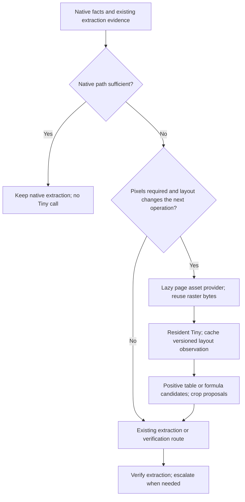

# Place Tiny layout on the conditional raster branch

Use the Tiny detector as a **lazy, cached page-layout evidence provider after native checks, before expensive pixel-dependent decisions and extraction**. Keep the healthy native-text route ahead of it. Initially collect shadow evidence and region candidates; do not let Tiny authorize `accept-text`, disable OCR, or declare a page complete.

This records the initial placement decision, checked against app/core `b4ee1a58` and experimental PR #88 before pipeline wiring. On 2026-10-21, a bounded post-plan PDF observer was implemented behind operator-only `PAGE_ROUTER_LAYOUT=shadow`; see [production integration](image-layout-production-integration.md). That milestone collects evidence without changing the plan. The conditional before-paid-call active design below remains future work, and the runtime is not deployed by default. The reviewed routing files are identical between those checkouts. [The measured findings](image-layout-confirmation-2026-10-20.md) still govern quality: the fast CPU pool is promising, but neither model passed the general-readiness gate.

## Current execution and costs

```text
split-pages -> extract-markdown -> classify-route -> route-pages
             -> render-images -> vision-extract
```

- [Stage order](../packages/shared/src/pipeline.ts#L740) places Markdown extraction before classification and the page router. [Dependencies](../packages/shared/src/pipeline.ts#L1159) explicitly require extracted evidence for these later decisions. Moving the entire page router ahead of extraction would break those dependencies.
- The [free native-text trust cascade](../worker/src/routing/trust.ts#L54) and [healthy-text shortcut](../worker/src/routing/routers/decision-model.ts#L101) should remain independent of the layout detector. Native prose should not acquire an extra model pass. Preserve this as the existing baseline behavior, not a new completeness guarantee: a zero table-rule score does not exclude borderless tables.
- The current probe nevertheless [renders every probed page at 72 DPI in grayscale and decodes it](../worker/src/routing/probe/probe.ts#L214). If image triage is configured it makes a [second color-thumbnail render](../worker/src/routing/probe/probe.ts#L310), before the decision router filters uncertain pages. Existing comments describing a render-free shortcut do not describe the whole probe path.
- [OCR-layer verification](../worker/src/stages/route-pages.ts#L218) is also enabled before the router sees the pages. Its band re-OCR cost is already incurred at a hook after `buildPageInputs`; Tiny cannot recover that cost or replace the text-agreement check.
- [Optional self-critique](../worker/src/stages/extract-markdown.ts#L1278) defaults off with zero budget, but when enabled it can render and call the configured vision runtime before `route-pages`. A later detector cannot avoid those earlier calls.
- [Source and encoded-raster caches](../worker/src/stages/index.ts#L46) are shared by stages. Probe thumbnails bypass that durable raster cache. The resident detector accepts encoded bytes and decodes in Python; no shared decoded-pixel buffer exists between it and the Node worker.

## Recommended branch



The provider is a shared service seam, not an unconditional new stage. One observation can feed the router and later extraction consumers without executing the detector twice.

| Input or request | Initial behavior |
|---|---|
| Healthy native PDF prose | Skip Tiny; retain native-text checks and extraction. |
| Native PDF table/image geometry already available | Prefer native spans, image boxes and validated native table candidates. Do not rasterize just to rediscover them. |
| Scan, suspect native text, or an existing raster with a requested layout-dependent operation | Tiny may propose regions for OCR/structure/vision. Keep the whole-page text obligation until the actual extractor verifies coverage. |
| Plain page OCR with no consumer for region evidence | Skip Tiny initially: it cannot transcribe text, so the extra pass has no established saving. |
| Standalone photograph or unknown image | Preserve the image/vision path. No native text is normal for a photograph; it does not prove the image is a scanned document. |
| Detector timeout, unavailable model, invalid geometry, or no useful candidates | Keep the previous plan and its escalation path. Record the reason; an empty result is not proof of an empty/simple page. |

## Exact integration seams

1. **Split the PDF probe into native facts and lazy pixel work.** Classify candidates from native/text facts before requesting thumbnails, image-quality statistics or OCR-layer agreement. Preserve agreement whenever a decision would trust an OCR text layer. Do not remove the existing image-quality or unusual-feature checks from pages that require them.
2. **Inject the lazy provider from `RoutePagesStage`.** [The document orchestration](../worker/src/stages/route-pages.ts#L212) constructs inputs before calling `router.plan`. Give that stage the existing shared raster provider rather than a new renderer. Call the cache/provider directly; do not wait for the later `render-images` stage or its route-plan-dependent artifact, which would introduce a routing/render dependency cycle. Invoke layout inside the router after free checks, before the first paid operation it might affect. The [inset gate](../worker/src/routing/routers/decision-model.ts#L182) can call a model before the embedding/content prefilter, so adding layout only next to the later prefilter misses that opportunity. Native inset boxes remain preferable to whole-page layout inference.
3. **Store a typed observation, not a calibrated decision answer.** [Page input/features](../packages/shared/src/page-routing.ts#L264) currently have no layout-observation field. Add an optional sibling artifact/reference carrying source/payload identity, model/graph revision, transforms, raw labels/confidence, timings and applicability. Do not overwrite `native.tableRuleScore`, `pTrustTextLayer` or the calibrated `DecisionAnswers` with detector scores.
4. **Adapt planner evidence explicitly and conservatively.** A detected table/formula can request structure/math verification or a crop. The baseline and heuristic routers will not consume an arbitrary new field automatically. [Current role construction](../worker/src/routing/planner.ts#L279) replaces ordinary text/OCR roles with page-level table/math roles; simply raising a table probability can therefore remove a text obligation. Region enrichment must preserve that obligation and retain uncovered-page fallback.
5. **Reuse the observation during execution.** Existing [region-scoped execution](../worker/src/routing/executors/run.ts#L162) and [native clip rendering](../worker/src/routing/executors/deps.ts#L85) are the natural consumers. The [table gate](../worker/src/routing/gates/shadow.ts#L33) currently runs after planning in shadow mode and only examines pages selected by existing signals. Adding raster candidates needs an explicit candidate/selection path. A detector rectangle is not a validated table grid or correct cell text.
6. **Add raw-image support deliberately.** [RoutePagesStage currently skips non-PDF inputs](../worker/src/stages/route-pages.ts#L164), and [render-images reads active plans only for PDFs](../worker/src/stages/render-images.ts#L55). An image-native page-1 builder and both plan consumers must change together. Do not synthesize PDF scan probabilities from an image's naturally absent native text layer.

## Asset, cache and service contract

- Reuse already-materialized encoded page bytes first. Let the provider return a bounded local byte/path lease together with its artifact identity, so a newly rendered page does not have to be uploaded and immediately downloaded for local inference. Persist artifacts where required for retries or downstream consumers; a lease must not become a cross-worker local-path assumption. Decode reuse across Node, the Python detector and external OCR is additional work, not an existing optimization. Request the layout observation once per page/profile and share its result across consumers.
- A new render profile must include tenant scope, source SHA, page, renderer/version, DPI or bounded dimensions, crop, rotation and encoding. Keep payload SHA distinct from original PDF/image SHA. Cache layout results with payload SHA, model checkpoint/ONNX graph digest, preprocessing/options and decision threshold; invalidate when any changes.
- The current durable PDF raster cache is run/document/page/DPI/engine-scoped, defaults to 150 DPI, and lacks full-page max-edge/codec controls. Extend that contract before introducing routing derivatives. Do not silently replace extraction/preview pixels or treat the existing 384-pixel decision thumbnail as a validated Tiny input. The campaign's aggressive downsizing lost layout recall.
- Convert normalized stored-image boxes through the renderer's exact page transform before creating PDF-point assignment boxes. Preserve rotation/crop/EXIF conventions. If the transform is unavailable, keep whole-page processing rather than guessing coordinates. Image-native coordinates need their own explicit contract.
- Use the resident [raw-byte adapter](../worker/src/layout/image-layout.ts#L206), pinned model and graph identity, bounded requests, cancellation/backpressure and scoped compute accounting. Per-page cold CLI process/model loading defeats the intended fast path.
- PR #88's HTTP server is single-process and serial. Its separate eight-worker benchmark reached 93–95 pages/s on a clean development slice; the router does not inherit that throughput. Multiworker HTTP dispatch/worker-affinity and end-to-end queueing require separate implementation and measurement. The standard worker image also does not yet package this runtime.
- Keep detector confidence as model evidence. It is not a calibrated probability that all content was found. Missing detections, high scores and generic `figure` cannot clear text, table, photo or inset obligations.

## Earlier initial-extraction fast path

If the goal is to avoid initial OCR/parser or self-critique work, add a **separate lightweight source-facts/precheck artifact after `split-pages` and before `extract-markdown`**, or a lazy hook immediately before an expensive extractor/critique call. It must depend only on source/native evidence, not canonical Markdown or classification produced later. Native facts should settle ordinary born-digital inputs without Tiny. For already-raster inputs, the same layout provider can be invoked when its output has a real consumer.

Keep final `route-pages` after extraction so it can reconcile actual extracted content with early facts. Reuse the early observation; do not run Tiny again there. Do not move the existing post-extraction router wholesale or put neural layout in universal format detection. Also avoid running native probe OCR/render work twice when early facts are reused.

## Integration acceptance experiment

The implemented observer starts `off`/`shadow` through the [operator contract](image-layout-production-integration.md#resident-service-and-bounds). The before-paid-call active provider still needs implementation. Shadow must record observations and a proposed plan without changing extraction or enabling paid calls. Establish an explicit shadow render/CPU budget; generating every page solely for shadow inference would itself be a regression.

Compare the unchanged router against the conditional provider on the same source groups and downstream extraction requirements. Measure:

- Eligible pages, bypassed native pages, bytes/renders/decodes per page, observation cache hits and duplicate work avoided.
- Actual OCR/vision/triage calls and their cost, not just layout inference time; include cold load, idle resident capacity and queueing.
- Accepted-page completeness, missed paragraphs/regions, table structure/text quality, false-positive escalations and fallback rate. Keep borderless tables, mixed native-plus-image pages, full-page scans, photographs and rotations in independent holdout groups. Include a model-blind audit sample of bypassed native pages so that the bypass itself does not hide missed structure.
- End-to-end p50/p95 latency and throughput at intended concurrency. Separately report producer/render time, model time and extraction/verification time.
- Native-shortcut preservation, provider unavailable/timeout behavior, source/graph/cache invalidation, tenant isolation and exact coordinate mappings.

For eligible pages, a simplified serial break-even is `added_layout_cost < avoided_fraction × avoided_downstream_cost`. Include any new rendering, decoding and verification in the added cost. The campaign measured detector/service speed; it did not establish an avoided-call fraction or production routing savings. Do not substitute a layout detector's latency for OCR/VLM extraction latency.

Promotion requires unchanged-or-better downstream completeness and a worthwhile end-to-end cost/latency improvement, with a frozen candidate and untouched confirmation groups. No acceptance threshold is derived from the already-inspected campaign holdouts.

## Checks for this placement decision

The 10 reviewed routing/pipeline source files were hash-compared with current app/core and matched the feature branch. Existing focused tests passed: 34 worker tests for trust, decision/inset gates and route-stage behavior, plus 6 shared tests for stage ordering and opt-in settings. An independent source review checked the proposed dependency boundaries. The new Mermaid diagram rendered with the installed Chromium, and the document link check passed. These are control-flow/contract checks; no new model inference, performance claim or production routing change was made.
