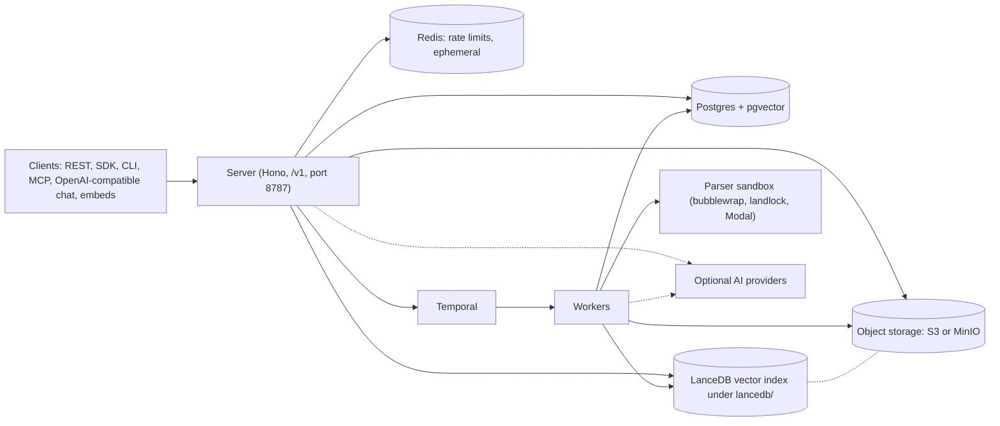

# Self-host DocSlurp

DocSlurp turns files into page-by-page Markdown, chunks, embeddings and structured fields, and serves them through search, RAG context and a cited chat endpoint. This section covers running it yourself.

Self-hosting is for two groups. Teams that need documents to stay on their own infrastructure can run the whole stack on one host. Developers who want to try DocSlurp, or build against it, can run the same stack locally.

The current install is a single host running Docker Compose. It is suitable for a small private installation or a server behind a TLS reverse proxy. It is not a multi-host or high-availability design. There is no bundled web UI; use the REST API, CLI, SDK or MCP.

[Architecture](architecture.md#system-map) explains each part.

## Choose your path

| Path | Status |
| --- | --- |
| Docker Compose on a single host | Available. Start with [Docker Compose](docker-compose.md). |
| Pluggable parser sandbox providers: bubblewrap, landlock and Modal | Available. See [Parser sandbox providers](sandbox-providers.md). |
| Terraform stacks for Fly, AWS, GCP, Vercel and Cloudflare | Planned |
| `docslurp deploy` setup wizard | Planned |
| Agent skill for guided setup | Planned |

## Pages

- [Docker Compose](docker-compose.md): install on one host, start, check and stop the stack, and switch between the lean and full worker.
- [Configuration](configuration.md): environment options, storage and vector index URIs, and AI providers.
- [Public access](public-access.md): TLS reverse proxy, forwarded headers and client IP handling.
- [Operations](operations.md): backups and restore, upgrades, and troubleshooting.
- [Architecture](architecture.md): system map, ingest sequence, trust boundaries and Compose topology.
- [Requirements](requirements.md): host requirements, sizing and GPU.
- [Security](security.md): parser sandbox, malware scanning, secrets and network exposure.
- [Parser sandbox providers](sandbox-providers.md): bubblewrap, landlock and Modal, selection, production policy and benchmarks.
