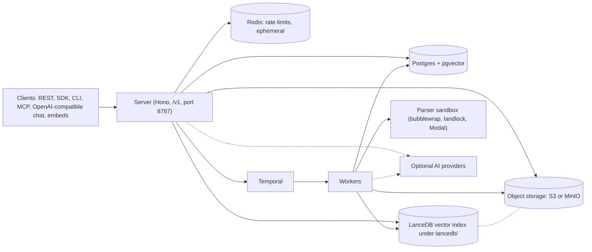
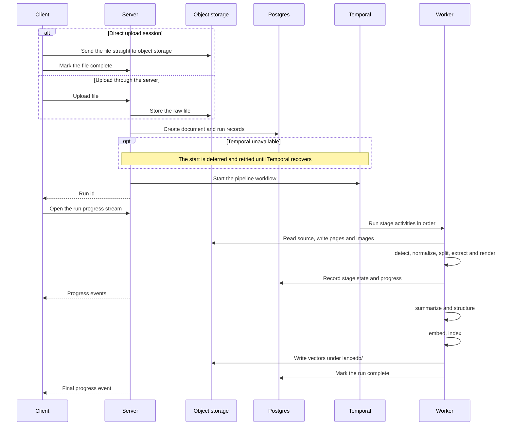
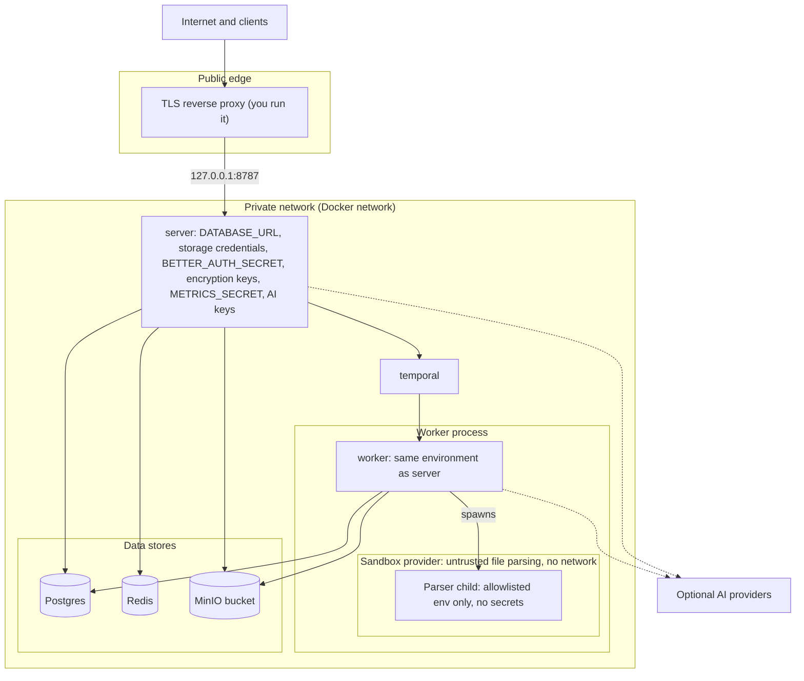
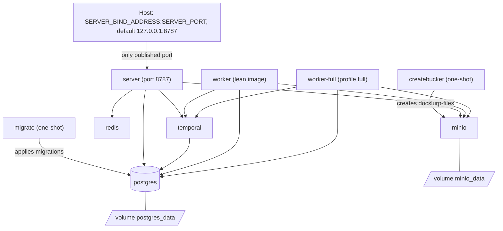

# Architecture

How the pieces of a self-hosted DocSlurp fit together. Design decisions that cut across packages are in [Architecture notes](../architecture.md). This page is about the running system.

## System map

Clients talk only to the server. The server is a Hono API under `/v1` on port 8787. It reads and writes Postgres (with pgvector), uses Redis for rate limits only, and stores raw and derived files in object storage (MinIO in the Compose stack). LanceDB vector indexes live in the same bucket under `lancedb/`. The server starts pipeline runs on Temporal. Workers pick them up, run the ingestion stages, and write results to Postgres, object storage and LanceDB. Workers run file parsers inside a sandbox provider: bubblewrap by default, or landlock or Modal ([providers](sandbox-providers.md)). AI providers are optional (dashed lines): the default local embedding mode needs no provider key, but LLM-powered stages do.

## Ingest sequence

An upload becomes a raw file in object storage and a run record in Postgres. The file can go through the server or straight to object storage with an upload session (`server/src/routes/uploads.ts`). The server then starts a Temporal workflow and returns the run id. If Temporal is down, the run stays queued and the server retries the start with backoff (`server/src/services/run-lifecycle.ts`). The worker runs the stages in order: detect, normalize, split, extract and render, then summarize and structure, then embed and index. The exact stage list is `WORKFLOW_STAGE_ORDER` in `worker/src/temporal/workflow-stage-order.ts`. It also holds smaller steps, such as quarantine and PII detection, that the diagram folds into the named groups. Clients watch a run through the server-sent event stream at `GET /v1/runs/:runId/progress/stream`. Once the run is complete, the document is searchable and available to chat.

## Trust boundaries

Only the reverse proxy faces the internet. The Compose file publishes one host port, the server's, and binds it to `127.0.0.1` by default. Postgres, Redis, MinIO and Temporal have no host ports.

The `server` and `worker` services share one environment block in `compose.selfhost.yml`, plus whatever is in `.env.selfhost`. Both therefore hold `DATABASE_URL`, the storage credentials (`AWS_ACCESS_KEY_ID`, `AWS_SECRET_ACCESS_KEY`), `BETTER_AUTH_SECRET`, `OAUTH_TOKEN_ENCRYPTION_KEY`, `CREDENTIALS_ENCRYPTION_KEY`, `SECRETS_ENCRYPTION_KEY`, `METRICS_SECRET` and any AI provider keys. Treat a worker compromise as a server compromise. The one-shot `migrate` service gets only `DATABASE_URL`. `postgres`, `minio` and `temporal` get the database password or storage credentials they need to run.

The parser sandbox is the boundary that matters for untrusted files. A parser runs as a child of the worker with an allowlisted environment, so it holds none of the secrets above, and it has no network (bubblewrap blocks all of it; landlock blocks TCP connect and bind, and runs only on kernels that expose Landlock ABI v9). With the Modal provider the parser runs on Modal's infrastructure instead of the worker host. [Security](security.md#parser-sandbox) lists what the sandbox isolates and which commands skip it.

## Compose topology

`compose.selfhost.yml` defines `postgres`, `redis`, `minio`, `createbucket`, `temporal`, `migrate`, `server` and `worker`, plus `worker-full` under the `full` profile. `createbucket` and `migrate` are one-shot services (`restart: "no"`). `server` waits for `migrate` and `createbucket` to complete, for `redis` to be healthy and for `temporal` to start. Each worker waits for `migrate` and `createbucket` to complete and for `temporal` to start. Two named volumes hold state: `postgres_data` and `minio_data`. Redis writes nothing to disk. The only host binding is `${SERVER_BIND_ADDRESS:-127.0.0.1}:${SERVER_PORT:-8787}`, which maps to the server's port 8787. `worker-full` replaces `worker` as the queue consumer rather than running beside it; [Docker Compose](docker-compose.md) has the commands.
