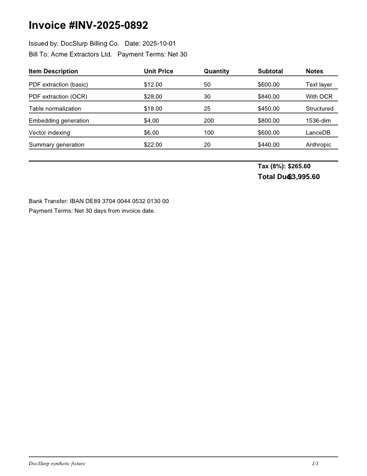

# Exact probe pixel-statistics optimization

Accepted locally: share the existing grayscale histogram for brightness and contrast, replacing the separate brightness traversal. All blur/contrast/brightness values and complete native probe rows match exactly (excluding `probeMs`). Both render profiles and OCR verification behavior remain unchanged.

| Slice | Phase | Baseline ms/page | Candidate ms/page | Median paired time reduction | Paired ratio range |
|---|---|---:|---:|---:|---:|
| kreuzberg-tables-invoice.pdf | screen | 34.69 | 22.43 | 38.0% | 0.540–0.647 |
| multicolumn-figures-report.pdf | screen | 43.40 | 30.77 | 29.1% | 0.616–0.856 |
| tables-multipage-financials.pdf | confirm | 46.57 | 23.97 | 45.1% | 0.475–0.664 |
| kreuzberg-formulas-math.pdf | confirm | 44.86 | 28.39 | 39.9% | 0.538–0.836 |

Five independent warm process blocks per phase, alternating baseline/candidate order; three complete document passes per arm per block. The confirmation set has one three-page table document and one one-page math document, with 60 timed page probes per arm. These are four synthetic source documents overall, not a representative production traffic estimate. All samples retained; no outliers excluded. The earlier `screen--1.json` is an unmodified A/A instrument run and is excluded from treatment summaries.

Both confirmation slices passed the preregistered >=5% stats-kernel gain and <=5% full-probe regression gates. Kernel median paired time reductions are 81.9% (tables-multipage-financials.pdf), 80.7% (kreuzberg-formulas-math.pdf). The wider total-probe speedup depends on the amount of rendering/native parsing work. Histogram iteration and removal of the redundant brightness scan were tested as one coherent bundle; no isolated attribution between those two changes is claimed.

## Usage and cost

No LLM/OCR/API calls, GPU time, paid hosts or production traffic. Full-probe timing includes opening the PDF, native facts, 72-DPI grayscale rendering, Sharp decode and image diagnostics. It excludes optional color thumbnails and optional OCR-layer verification. Existing focused tests exercise color thumbnails and OCR verification; benchmark performance for those modes is unmeasured. Raw per-arm process CPU time is recorded alongside wall time. CPU per page is not whole-host utilization, and savings in dollar bills are unmeasured. No changes to model/token usage.

## Reproduce

Use Node v26.8.2, native-pdf 0.13.0 (`8709e8c20c5c27fd11ec51f72e6fc8e055e2c714`), and the current checkout dependencies. Set `DOCSLURP_NATIVE_PDF_MODULE` to the installed local binding directory, and `TMPDIR`, `TMP`, `TEMP` to your agent scratch directory. From repository root:

```sh
for phase in screen confirm; do
  for block in 0 1 2 3 4; do
    node_modules/.bin/tsx performance/probe-pixel-stats-2026-10-21/benchmark.mts "$phase" "$block"
  done
done
```

Raw JSON records source SHA256, native version, CPU model, source PDF hashes, output semantic hashes and timings. Baseline source is reconstructed from `5fe9ac4e1ea4ddaf61319a271a729c0365bb1758`. The benchmark validates exact rows and explicitly checks that dropped-page output fails the equality oracle. Initial harness launch failed before workload execution because `.ts` inherited CommonJS; renamed to `.mts`, no failed timings were used.

## Checks and image evidence

12 focused tests passed with the actual native binding enabled, including independent sorted-array percentile/brightness oracles for empty, flat, alternating and noisy pixels and offset subarrays. Benchmark confirms exact semantic rows across all four PDF inputs. Broader worker checks belong to the combined integration validation.



Image: first page of original repository-authored `worker/testdata/pdf-fixtures/kreuzberg-tables-invoice.pdf`, rendered by native-pdf 0.13.0 on 2026-10-21 around 13:59 MDT. This is the actual benchmark input resolution, not a generated status illustration.
